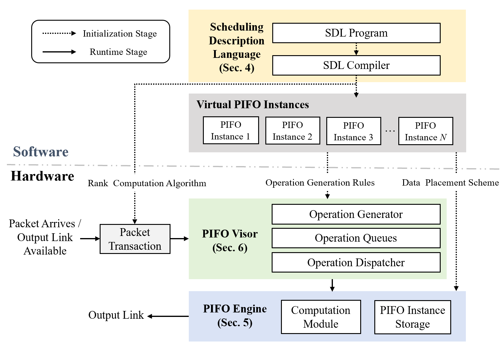

# vPIFO：可编程分层调度与 FPGA 实现

本仓库包含 vPIFO 的硬件和软件代码。原版 vPIFO 使用调度描述语言（SDL）及其编译器描述调度关系，由 PIFO Visor 将数据包事件转换为操作，再交给 FPGA 上的 PIFO Engine 执行。本仓库还包含异构容量的 FPGA RTL、整形与多层调度模块、配置生成工具、测试平台，以及原论文 FPGA 实现的复现脚本。



## 代码在哪里

| 路径 | 内容 |
| --- | --- |
| `hardware/BMW_PIFO_SRAM_vPIFO/` | BMW-Tree PIFO 引擎、异构逻辑 PIFO、分层调度与流量整形 RTL；`*_tb.sv` 是仿真测试平台 |
| `hardware/BMW_PIFO_SRAM_vPIFO/config/` | JSON 配置、配置生成器、Python 单元测试和 PowerShell 回归脚本 |
| `hardware/BMW_PIFO_SRAM_vPIFO/generated*/` | 配置生成器输出的 SystemVerilog package、Tcl 参数和清单；RTL 构建会读取这些文件 |
| `hardware/three_tier_experiments/` | 三层调度封装、对照测试平台及 Verilator/Vivado 运行脚本 |
| `hardware/paper_reproduction/` | 原论文 FPGA 综合与实现复现流程，以及隔离的基线 RTL；详见[复现说明](hardware/paper_reproduction/README.md) |
| `hardware/BMW_PIFO_SRAM_vPIFO_{2,4,8}/` | 不同 BMW order 的 PIFO RTL |
| `software/SDL_compiler/` | 原版 SDL 编译器及扩展的 VPIFO 注解前端 |
| `software/experiment/` | DPDK 调度器和 ns-3 仿真代码，各自需要单独安装依赖 |

异构容量配置的字段与容量计算见[配置说明](hardware/BMW_PIFO_SRAM_vPIFO/CONFIGURATION.md)；双执行域、调度森林和注解语法见[通用化设计说明](hardware/BMW_PIFO_SRAM_vPIFO/VPIFO_GENERALIZATION.md)。

## 开始使用

以下命令均从仓库根目录执行，除非步骤中明确切换目录。

### 环境

- **运行 RTL 仿真：** Windows PowerShell、WSL，以及在 WSL 中可用的 Verilator、C++ 编译器和 `make`。本文的三层测试曾用 Verilator 5.032 验证。PowerShell 回归脚本通过 `wsl.exe` 调用 Verilator，并假定仓库所在盘符在 WSL 中挂载为 `/mnt/<盘符>`。
- **生成配置和运行 Python 测试：** Python 3。原版软件实验文档使用 Python 3.8.10；独立运行硬件配置生成和测试时无需安装 DPDK 或 ns-3。
- **运行 FPGA 综合/实现：** Vivado。原论文使用 Vivado 2018.3，仓库中的论文复现脚本也在 2019.2 环境下使用；只有板卡实验才需要 Xilinx Alveo U200。
- **运行原版软件实验：** ns-3.26 或 DPDK 17.08.1，取决于所运行的子项目；参见相应目录内的说明。

### 1. 运行三层调度的最小 RTL 测试

在 WSL 终端中：

```sh
cd hardware/three_tier_experiments
sh ./run_boundary21_verilator.sh 8 2 obj_dir_boundary_h21_d8_smoke
cd ../BMW_PIFO_SRAM_vPIFO
./obj_dir_boundary_h21_d8_smoke/VThreeTierScheduler_tb
```

三个参数依次为异构引擎的 pending 深度、每个叶节点送入的数据包数，以及 Verilator 构建目录名。上例以 16 个叶节点、每叶 2 包运行；通过时测试程序输出 `PASS`。完整容量测试可把第二个参数改为 `126`，并使用新的构建目录名。

### 2. 修改逻辑 PIFO 容量并运行回归

编辑 `hardware/BMW_PIFO_SRAM_vPIFO/config/vpifo_config.json` 中的 `required_capacity`。它表示各逻辑 PIFO 需要容纳的数据包数；生成器据此计算每个逻辑 PIFO 占用的物理 BMW shard 数量及偏移。配置在**生成和重新编译时**生效，不会在 RTL 运行期间动态改变。

在 PowerShell 中生成并检查配置，然后运行平面与分层两种测试：

```powershell
python .\hardware\BMW_PIFO_SRAM_vPIFO\config\generate_vpifo_config.py
python .\hardware\BMW_PIFO_SRAM_vPIFO\config\generate_vpifo_config.py --check
& .\hardware\BMW_PIFO_SRAM_vPIFO\sim_heterogeneous.ps1 -Test generated_flat
& .\hardware\BMW_PIFO_SRAM_vPIFO\sim_heterogeneous.ps1 -Test generated_hierarchical
```

生成器写入 `generated/vpifo_config_pkg.sv`、`generated/vpifo_config.tcl` 和 `generated/vpifo_config_manifest.json`。编译 RTL 时应先加入生成的 package。要测试仓库提供的多组容量配置，可运行：

```powershell
& .\hardware\BMW_PIFO_SRAM_vPIFO\config\run_generated_config_regression.ps1
```

该回归会切换测试配置，并在结束时恢复主配置对应的生成文件。更多配置限制及测试命令见[配置说明](hardware/BMW_PIFO_SRAM_vPIFO/CONFIGURATION.md)。

### 3. 运行通用化 VPIFO 测试

`GeneralizedVPIFO.sv` 使用独立的 schedule 和 timing 执行域；编译期配置定义节点类型、容量和 timing 节点到 schedule 叶节点的释放关系。运行 Python 检查、配置生成及两种 RTL 回归：

```powershell
& .\hardware\BMW_PIFO_SRAM_vPIFO\config\run_generalized_vpifo_regression.ps1
```

也可以把 VPIFO 注解编译为配置 JSON 和 RTL package。例如在 PowerShell 中：

```powershell
python .\software\SDL_compiler\generalization\compile_vpifo_annotations.py `
  .\software\SDL_compiler\generalization\examples\two_domain.vpifo `
  --output "$env:TEMP\vpifo_demo.json" `
  --rtl-output-dir "$env:TEMP\vpifo_demo_generated"
```

注解前端和执行域的边界见[通用化设计说明](hardware/BMW_PIFO_SRAM_vPIFO/VPIFO_GENERALIZATION.md)。当前通用化的 schedule 域支持多个“根节点 + 叶节点”的两层语义树；节点类型和连接关系在生成配置时确定。

### 4. 原论文 FPGA 点的复现

`hardware/paper_reproduction/` 提供独立的基线源码及 Vivado 脚本。输入参数、源码模式、综合与布局布线命令见[该目录的 README](hardware/paper_reproduction/README.md)。这一路径用于原论文配置的复现，不依赖上述异构容量或整形扩展。

## 生成文件与实验结果

Verilator 的 `obj_dir*`、Vivado 工作目录、`runs/` 下的资源与时序报告、CSV 和图表均可由脚本重新生成，不作为本次代码发布内容。`generated*/` 中的 package、Tcl 和清单是构建 RTL 所需的配置产物，已随源码保留。运行脚本后如需判断工作区变化，可执行 `git status --short`。

## 原版软件与相关链接

原版 vPIFO 包括 SDL 编译器、DPDK 软件调度器和 ns-3 实验代码。DPDK 子项目的安装与运行步骤见[软件目录说明](software/experiment/DPDK_scheduler/Readme.md)。相关工具：[BMW-Tree](https://github.com/BMWTree/BMWTree)、[DPDK](https://www.dpdk.org/)、[ns-3](https://www.nsnam.org/)、[Vivado](https://www.xilinx.com/support/download/index.html/content/xilinx/en/downloadNav/vivado-design-tools/archive.html)。

## 许可证

本项目使用 [Apache-2.0](LICENSE) 许可证。
